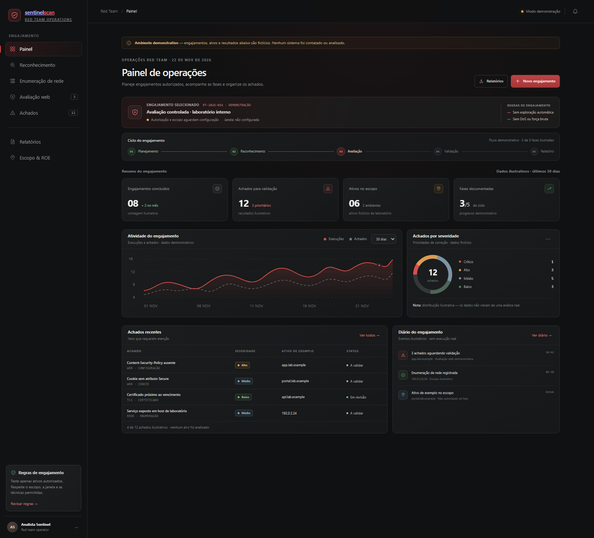
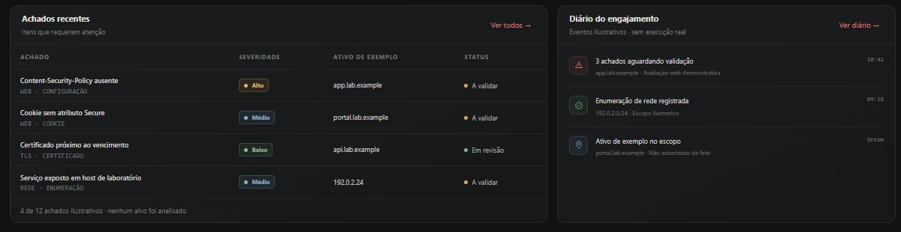

# SentinelScan

**Plataforma em desenvolvimento para organizar engajamentos de Red Team autorizados.**

O SentinelScan reúne uma interface de operações e uma API local para registrar escopo, alvos autorizados e atividades de auditoria. O projeto está sendo construído por etapas, com foco em segurança, transparência e uso responsável.

> [!IMPORTANT]
> Esta versão **não executa reconhecimento, varredura de portas, testes web nem exploração**. Os números, eventos e alvos mostrados na interface são ilustrativos; nenhum sistema foi contatado. O cadastro de um alvo registra a declaração do operador, não comprova autorização.

## Capturas de tela

As imagens abaixo mostram a interface de demonstração. Os dados e resultados visíveis são fictícios.

### Painel desktop



### Achados e atividade do engajamento



## O que o projeto demonstra

- Interface responsiva em HTML, CSS e JavaScript.
- Organização de um engajamento por fases: planejamento, reconhecimento, avaliação, validação e relatório.
- Registro de escopo e regras de engajamento (ROE) como conceitos centrais da experiência.
- API REST em FastAPI para cadastrar e desativar alvos de laboratório e consultar eventos de auditoria.
- Persistência local em SQLite, validação de dados e testes automatizados para os endpoints implementados.
- Desenvolvimento incremental: funcionalidades ainda não implementadas são identificadas, em vez de simuladas como resultados reais.

## Estado atual

| Componente | Estado |
| --- | --- |
| Interface e navegação | Implementadas; indicadores e atividades são dados demonstrativos |
| API e documentação OpenAPI | Implementadas; documentação disponível em `/docs` |
| Cadastro, consulta e desativação de alvos | Implementados na API |
| Registro de escopo e confirmação declarada de autorização | Implementados no cadastro |
| Trilha de auditoria de alterações de alvos | Implementada |
| Integração entre os formulários do painel e a API | Ainda não implementada |
| Reconhecimento DNS, Nmap, verificações web e OWASP ZAP | Ainda não implementados |
| Relatórios PDF | Ainda não implementados |

## Tecnologias

- **Frontend:** HTML5, CSS3 e JavaScript
- **Backend:** Python e FastAPI
- **Banco de dados:** SQLite
- **Testes:** pytest e HTTPX

## Estrutura

```text
SentinelScan/
├── backend/
│   ├── app.py                 # Aplicação FastAPI e servidor dos arquivos do site
│   ├── database.py            # Esquema SQLite e eventos de auditoria
│   ├── schemas.py             # Validação dos dados da API
│   └── routes/
│       ├── audit.py           # Consulta da trilha de auditoria
│       └── targets.py         # Cadastro, listagem e desativação de alvos
├── css/
│   └── styles.css
├── docs/
│   └── images/                # Capturas de tela para a documentação
├── js/
│   └── app.js
├── tests/
│   └── test_api.py
├── index.html
├── requirements.txt
└── README.md
```

## Executar localmente

Requisitos: Python 3.10 ou superior e pip.

No PowerShell, na pasta do projeto:

```powershell
py -m venv .venv
.\.venv\Scripts\Activate.ps1
python -m pip install -r requirements.txt
python -m uvicorn backend.app:app --host 127.0.0.1 --port 8000
```

Se o comando `py` não estiver disponível, crie o ambiente com `python -m venv .venv`.

- Aplicação: <http://127.0.0.1:8000>
- Documentação interativa da API: <http://127.0.0.1:8000/docs>
- Verificação de saúde: <http://127.0.0.1:8000/api/health>

O servidor de desenvolvimento é vinculado a `127.0.0.1` para aceitar conexões apenas da máquina local.

## API disponível

| Método | Endpoint | Descrição |
| --- | --- | --- |
| `GET` | `/api/health` | Estado da API e modo atual |
| `GET` | `/api/targets` | Lista os alvos ativos |
| `GET` | `/api/targets?active_only=false` | Lista alvos ativos e desativados |
| `POST` | `/api/targets` | Cadastra alvo, escopo e confirmação explícita de autorização |
| `DELETE` | `/api/targets/{id}` | Desativa um alvo sem apagar o registro |
| `GET` | `/api/audit` | Lista eventos recentes de auditoria |

Exemplo de requisição para `POST /api/targets`:

```json
{
  "name": "Laboratório interno",
  "target": "lab.example",
  "scope_description": "Somente o host de aplicação deste laboratório.",
  "exclusions": ["admin.lab.example"],
  "authorization_reference": "ROE-2026-01",
  "authorization_confirmed": true
}
```

O sufixo `.example` é reservado para documentação e não identifica um alvo real.

## Testes

Com as dependências instaladas:

```powershell
python -m pytest
```

Os testes cobrem o estado da API, a entrega da interface, a confirmação de autorização, a validação e normalização de alvos, duplicidade, desativação e auditoria.

## Uso responsável e próximos passos

Use ferramentas de segurança somente em laboratórios próprios ou ativos para os quais exista autorização explícita. Defina escopo, exclusões, janela e regras de engajamento antes de qualquer teste.

Esta versão não oferece autenticação e não valida autorização de forma independente. Não exponha a API na rede nem a utilize para executar testes. Antes de integrar qualquer scanner, o projeto precisa de controles de identidade e acesso, validação do escopo em cada execução, limites de recursos e duração, proteção contra redirecionamentos para destinos fora do escopo e auditoria das ações.

Próximas etapas planejadas:

1. Conectar o frontend à API e substituir os indicadores estáticos por dados persistidos.
2. Construir cadastro e revisão explícita de engajamentos, escopo, exclusões e ROE.
3. Implementar verificações passivas e não destrutivas limitadas aos alvos autorizados.
4. Adicionar relatórios e ampliar os testes automatizados.

## Aviso

Este repositório é um projeto educacional e de portfólio em desenvolvimento. A presença de campos de autorização ou escopo não constitui autorização para testar qualquer sistema.
